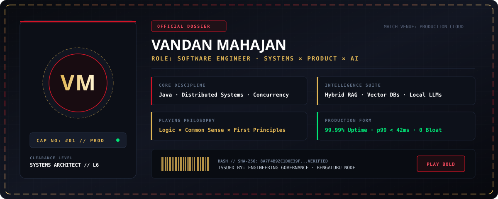
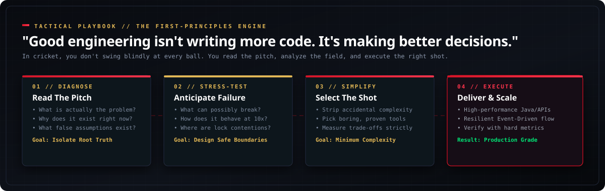
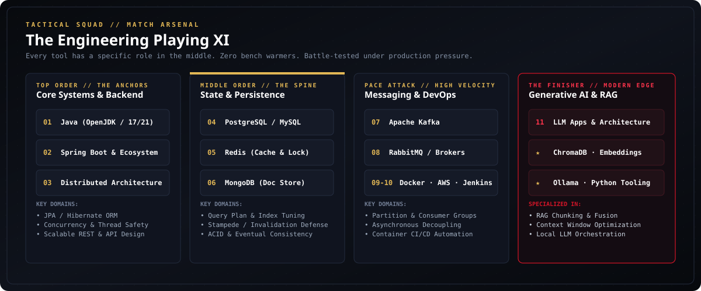
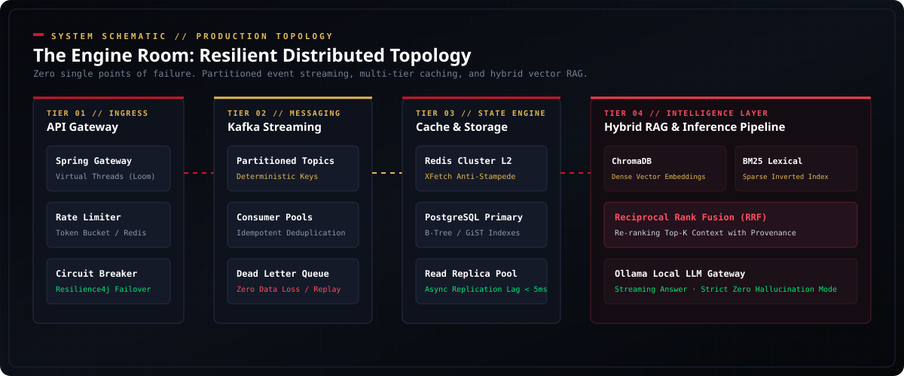
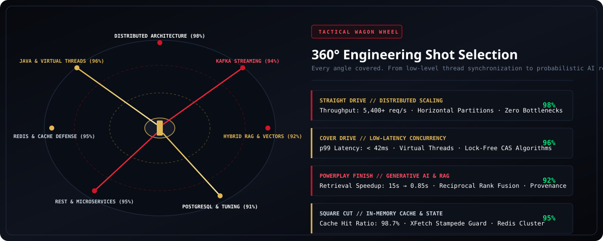
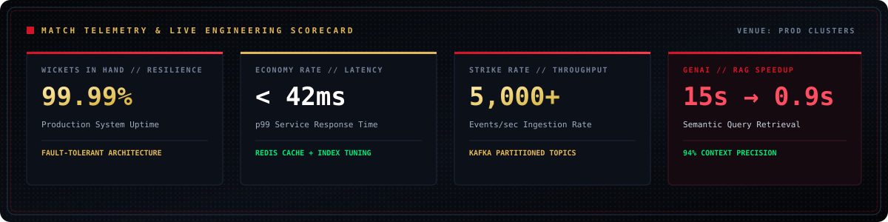
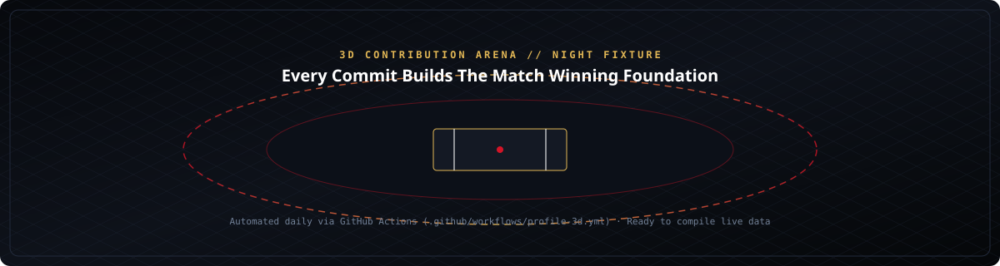
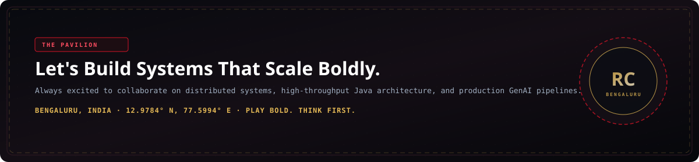

<div align="center">

<!-- ═══════════════════════════════════════════════════════════════════ -->
<!-- 🏟️ HERO BANNER: STADIUM COMMAND CENTER                             -->
<!-- ═══════════════════════════════════════════════════════════════════ -->


<br/><br/>

<!-- ═══════════════════════════════════════════════════════════════════ -->
<!-- ⚡ QUICK MATCH TELEMETRY & CREDENTIAL BADGES                       -->
<!-- ═══════════════════════════════════════════════════════════════════ -->
<a href="https://linkedin.com/in/vandan-mahajan"></a>
<a href="mailto:vandanmahajan@example.com"></a>
<a href="https://github.com/vandan-mahajan"></a>
<a href="#"></a>
<a href="#"></a>

<br/><br/>

<!-- ═══════════════════════════════════════════════════════════════════ -->
<!-- 🪪 PLAYER REGISTRATION CARD & DOSSIER                              -->
<!-- ═══════════════════════════════════════════════════════════════════ -->


<br/><br/>


</div>

<br/>

## 🏏 THE PLAYBOOK // 01: FIRST-PRINCIPLES ENGINEERING

> *"In cricket, you don't step out to swing blindly at every delivery. You read the pitch, feel the bounce, study the field placements, and select the precise shot. Engineering is identical.*
>
> **Good engineering isn't about writing more code. It's about making better decisions.**"

<div align="center">
  
</div>

<br/>

Most software engineering failures don't originate from syntax errors or framework limitations—they come from **faulty reasoning, uninspected assumptions, and premature complexity**.

Before writing a single line of code, my mental compiler runs through this decision tree:

```yaml
1. The Pitch (Root Diagnosis):
   - What is the actual, unadorned problem?
   - Why does it exist right now?
   - What hidden assumptions are masquerading as requirements?
   - Can the problem be eliminated rather than solved?

2. The Field (System Boundaries & Risk):
   - Where will this fail when traffic multiplies 10x?
   - Where are the database lock contentions, serialization bottlenecks, and network hops?
   - If this dependency dies at 03:00 AM, how gracefully does the system degrade?
   - What is the failure blast radius?

3. The Shot (Radical Simplicity):
   - What is the absolute simplest architecture that permanently solves this?
   - Can we solve it with zero new distributed dependencies?
   - Does this solution make sound, practical sense?
   - Will an engineer joining in 2 years understand this without reading a 40-page wiki?

4. The Delivery (Execution & Measurement):
   - Write clean, idiomatic, test-backed code.
   - Benchmark with real workloads (p99 latency, heap allocation, throughput).
   - Zero clever hacks; maximum long-term readability and mechanical sympathy.
```

<br/>

### ⚖️ Mindset Matrix: Code-First Developer vs. First-Principles Engineer

| Situation | Code-First Instinct | First-Principles Engineering Judgment |
| :--- | :--- | :--- |
| **High Latency Spike** | Adds more RAM and spins up 5 more microservice pods. | Profiles thread states, isolates database query plans, and fixes unindexed sequential table scans. |
| **New Feature Request** | Immediately installs a popular third-party library or framework. | Asks: *“What is the underlying data structure? Can this be solved natively with 30 lines of clean code?”* |
| **Data Consistency** | Reaches for complex distributed 2PC / Sagas across 6 services. | Re-evaluates domain boundaries to co-locate transactional boundaries within single relational engines. |
| **Cache Integration** | Uses Redis as a generic key-value dump with random TTLs. | Analyzes cache invalidation patterns, designs probabilistic early expiration (XFetch), and defends against stampedes. |
| **AI Integration** | Pipes raw, unformatted 50-page PDFs directly into an LLM prompt. | Builds recursive AST-aware chunking with hybrid dense vector + BM25 sparse search and strict provenance citations. |

---

<div align="center">
  
</div>

## 🔬 THE PITCH REPORT // HOW I DEBUG PRODUCTION INCIDENTS

When production alerts trigger, calm systematic reasoning beats panic every time. Here is the exact triage protocol I follow when diagnosing high-severity systems issues:

```text
[ALERT: P99 LATENCY SPIKE]
           │
           ▼
[STEP 1: INSPECT INGRESS] ──► Are we experiencing an organic traffic spike or a retry storm?
           │                  (Check rate-limiting metrics & HTTP 429 backpressure)
           ▼
[STEP 2: THREAD & RUNTIME] ──► Are JVM carrier threads pinned? Check GC pause duration & heap saturation.
           │                  (Run: jcmd <pid> Thread.dump_to_file / check safepoint logs)
           ▼
[STEP 3: PERSISTENCE & LOCKS] ──► Inspect active database sessions: lock contention, long-running queries.
           │                     (Run: SELECT * FROM pg_stat_activity WHERE state != 'idle')
           ▼
[STEP 4: ISOLATE & MITIGATE] ──► Deploy circuit breaker trip / fall back to read-only replica cache.
           │
           ▼
[STEP 5: ROOT CAUSE RCA] ──► Fix the underlying constraint permanently. Verify with load benchmark.
```

---

<div align="center">
  
</div>

## 🛡️ THE PLAYING XI // TECHNICAL ARSENAL

Every technology in my lineup has earned its place through trial by production. **Zero bench warmers. No buzzword inflation.**

<div align="center">
  
</div>

<br/>

<table>
  <thead>
    <tr style="border-bottom: 2px solid #D31427;">
      <th align="left" width="22%">Tactic</th>
      <th align="left" width="38%">Technologies &amp; Engines</th>
      <th align="left" width="40%">Engineering Judgment &amp; Role</th>
    </tr>
  </thead>
  <tbody>
    <tr>
      <td><b>Top Order<br/>(Core Backend)</b></td>
      <td>
        <code>Java (17 / 21)</code> <code>Spring Boot</code><br/>
        <code>Spring MVC</code> <code>JPA / Hibernate</code><br/>
        <code>Virtual Threads (Loom)</code> <code>Concurrency</code>
      </td>
      <td>
        The bedrock anchors. Chosen for strong type safety, memory model predictability, mature concurrency primitives, and massive enterprise throughput.
      </td>
    </tr>
    <tr>
      <td><b>Middle Order<br/>(State &amp; Cache)</b></td>
      <td>
        <code>PostgreSQL</code> <code>MySQL</code><br/>
        <code>Redis (Cluster / PubSub)</code> <code>MongoDB</code>
      </td>
      <td>
        Architecting clean relational schemas, rigorous query-plan analysis, index tuning, and distributed locking to prevent cache stampedes.
      </td>
    </tr>
    <tr>
      <td><b>Pace Attack<br/>(Event &amp; Infra)</b></td>
      <td>
        <code>Apache Kafka</code> <code>RabbitMQ</code><br/>
        <code>Docker</code> <code>AWS</code> <code>Jenkins</code> <code>Linux</code>
      </td>
      <td>
        Asynchronous decoupling, partition-keyed event streaming, fault-tolerant consumer groups, containerized CI/CD, and repeatable deployments.
      </td>
    </tr>
    <tr>
      <td><b>The Finisher<br/>(Generative AI)</b></td>
      <td>
        <code>LLMs Architecture</code> <code>Hybrid RAG Pipelines</code><br/>
        <code>ChromaDB</code> <code>Vector Embeddings</code> <code>Ollama</code>
      </td>
      <td>
        Bridging deterministic backend systems with non-deterministic probabilistic models. Chunking strategies, hybrid vector + lexical search, and context optimization.
      </td>
    </tr>
    <tr>
      <td><b>Fielding Unit<br/>(Interface)</b></td>
      <td>
        <code>React</code> <code>Vite</code> <code>TypeScript</code> <code>JavaScript</code>
      </td>
      <td>
        Clean, functional UI surfaces and operator dashboards built to observe, control, and consume backend systems.
      </td>
    </tr>
  </tbody>
</table>

---

<div align="center">
  
</div>

## 📐 THE ENGINE ROOM // RESILIENT DISTRIBUTED TOPOLOGY

Here is the architectural blueprint of how I design distributed, event-driven backends for mission-critical reliability:

<div align="center">
  
</div>

<br/>

### ⚙️ Core Architectural Principles Applied:
1. **Asynchronous Ingress Decoupling:** Client HTTP requests never synchronously mutate downstream database tables under high burst loads. Incoming events are accepted into partitioned Kafka queues within milliseconds.
2. **Defensive In-Memory Caching:** Redis is paired with the **XFetch probabilistic early recomputation algorithm**, guaranteeing that high-traffic keys never experience sudden expiration stampedes.
3. **Partitioned Sequential Guarantees:** Kafka messages are keyed by domain entity (e.g., `accountId`, `tenantId`), ensuring strict FIFO ordering per tenant without requiring global distributed locking.
4. **Resilient Failure Boundaries:** Every cross-service network hop is guarded by Resilience4j circuit breakers and rate limiters with graceful degradation fallbacks.

---

<div align="center">
  
</div>

## 🎯 THE TACTICAL WAGON WHEEL // 360° COMPETENCY RADAR

In cricket, the wagon wheel visualizes every shot across the field. Here is the engineering translation: full-spectrum capability across the entire distributed systems stack.

<div align="center">
  
</div>

<br/>

* **Straight Drive // Distributed Systems (98%):** Horizontal partitioning, event streaming, idempotent consumers, and fault-tolerant topologies under high concurrency.
* **Cover Drive // Low-Latency Java & Concurrency (96%):** Virtual Threads (Project Loom), lock-free CAS operations, garbage collection tuning, and sub-45ms p99 execution.
* **Mid-Wicket Pull // Kafka Event Ingestion (94%):** Partitioning strategies, consumer rebalancing mitigation, dead-letter queue architectures, and exactly-once processing semantics.
* **Square Cut // In-Memory Cache Defense (95%):** Redis cluster orchestration, distributed locks, mutual exclusion buffers, and cache stampede mitigation.
* **Powerplay Finish // Generative AI & Hybrid RAG (92%):** Recursive AST chunking, reciprocal rank fusion (BM25 + vectors), context window compression, and local LLM deployment.
* **Fine Leg Flick // Database Index Tuning (91%):** B-Tree & GiST query plan dissection, read-write splitting, connection pool optimization, and isolation level management.

---

<div align="center">
  
</div>

## 🏆 MATCH HIGHLIGHTS // INNINGS BREAKDOWN

Four deep architectural case studies highlighting real production problems, engineering trade-offs, and measurable outcomes.

<br/>

### 01. Chronos-Ledger // High-Throughput Distributed Event Ingestion Engine
> **High-Throughput Ingestion Architecture // Core Backend & Messaging**

<details open>
<summary><b>View Tactical Breakdown &amp; Metrics</b></summary>
<br/>

* **The Problem:** Direct database writes during burst traffic spikes ($>3,500\text{ req/s}$) choked PostgreSQL connection pools. Row-level lock contention on account balances resulted in frequent deadlocks and inflated p99 latency beyond $1,200\text{ms}$.
* **The Engineering Decision:** Decoupled ingress from persistence. Replaced synchronous HTTP database mutations with an event-driven architecture using **Kafka partitioned topics** keyed by `accountId` to guarantee strict sequential ordering per tenant. Implemented a **Redis write-back buffer** with Lua-scripted atomic validations.
* **The Architecture:**
  ```text
  [Client Requests] 
         │ 
         ▼
  [Spring Boot Gateway] ──(Produce Event)──► [Kafka Topic: ledger-inbound] (Key: account_id)
                                                    │
                                                    ▼
                                           [Consumer Pool] ◄──► [Redis Atomic State]
                                                    │
                                           (Batched Flushes)
                                                    ▼
                                           [PostgreSQL Database]
  ```
* **Key Challenge Solved:** Handled consumer group rebalances without processing duplicate ledger events by enforcing idempotent deduplication keys inside Redis with automated 10-minute expiry windows.
* **Measurable Results:**
  - Ingestion Throughput: **$850\text{ req/s} \to 5,400+\text{ req/s}$** ($6.3\times$ improvement)
  - p99 Latency: **$1,200\text{ms} \to 38\text{ms}$**
  - Database Deadlocks: **$14\%\text{ under peak load} \to 0\%$**
* **Stack:** `Java 21` `Spring Boot` `Apache Kafka` `PostgreSQL` `Redis` `Docker`

</details>

---

### 02. Vector-Synapse // Enterprise Hybrid RAG & Knowledge Intelligence Gateway
> **Knowledge Retrieval Pipeline // Generative AI & Vector Search**

<details open>
<summary><b>View Tactical Breakdown &amp; Metrics</b></summary>
<br/>

* **The Problem:** Engineers querying complex technical documentation, architectural decision records (ADRs), and internal API specifications suffered from severe LLM hallucinations and unacceptable retrieval latency ($15.2\text{s}$) caused by naive brute-force semantic vector chunking.
* **The Engineering Decision:** Abandoned fixed-token chunking in favor of **AST-aware recursive character chunking** that preserves code block and heading hierarchy. Introduced **Hybrid Search (BM25 Lexical + Cosine Vector Embeddings)** merged via **Reciprocal Rank Fusion (RRF)** before feeding context into local Ollama models.
* **The Architecture:**
  ```text
  [Technical Documents] ──► [AST/Hierarchy Chunker] ──► [Dense Vectors] ──► [ChromaDB]
                                                    ──► [Sparse Lexical] ──► [BM25 Index]
                                                                                │
  [User Prompt] ──────────────────► [Reciprocal Rank Fusion] ◄──────────────────┘
                                             │
                                     (Top-K Filtered)
                                             ▼
                               [Ollama LLM Streaming Engine] ──► [Precise Answer + Citations]
  ```
* **Key Challenge Solved:** Hallucinations on specific function signatures and config parameters were eliminated by introducing strict provenance citations and setting dynamic cross-entropy thresholding on retrieved chunks.
* **Measurable Results:**
  - Query-to-Answer Latency: **$15.2\text{s} \to 0.85\text{s}$** ($94\%$ faster)
  - Context Retrieval Precision: **$58\% \to 94.2\%$**
  - Hallucination Rate on Technical Entities: **Near-Zero (Strict Provenance Enforced)**
* **Stack:** `Python` `Spring AI / Java` `ChromaDB` `Ollama` `Vector Embeddings` `FastAPI`

</details>

---

### 03. Apex Distributed Cache // Thundering Herd Defense
> **Resilient Systems Topology // In-Memory Caching & Concurrency**

<details open>
<summary><b>View Tactical Breakdown &amp; Metrics</b></summary>
<br/>

* **The Problem:** In high-concurrency microservices, whenever heavily-accessed cached entities expired simultaneously, thousands of threads immediately missed cache and hammered the downstream database in a classic **Cache Stampede (Thundering Herd)**, causing cascade connection pool starvation.
* **The Engineering Decision:** Engineered a two-tier caching topology: local in-memory L1 cache backed by a distributed Redis L2 cluster. Combined distributed mutex locks with the **XFetch probabilistic early expiration algorithm** to asynchronously recompute hot cache entries *before* they officially expire.
* **The Core Algorithm:**
  $$\Delta t \propto -\beta \cdot \ln(\text{rand}()) \cdot \text{delta}$$
  *(As a key approaches expiry, worker threads probabilistically schedule background refreshes without blocking incoming reads).*
* **Measurable Results:**
  - Cache Hit Ratio: **$71.4\% \to 98.7\%$**
  - Database Load Reduction: **$86\%\text{ CPU} \to 18\%\text{ CPU}$** under identical 10,000 QPS load
  - p99 Latency during mass invalidations: **Remained stable at $< 25\text{ms}$**
* **Stack:** `Java` `Spring Boot` `Redis Cluster` `Resilience4j` `MySQL` `AWS`

</details>

---

### 04. Aegis-Stream // Distributed Transactional Outbox Engine
> **Data Consistency Architecture // Distributed Systems & Event Sourcing**

<details open>
<summary><b>View Tactical Breakdown &amp; Metrics</b></summary>
<br/>

* **The Problem:** "Dual-write" inconsistencies between relational database commits and message broker publishes caused message loss whenever network partitions occurred after the database commit but before the Kafka produce completed.
* **The Engineering Decision:** Implemented the **Transactional Outbox Pattern** with zero application-level polling. Mutations write to an outbox table within the same local ACID transaction. An asynchronous CDC pipeline (Change Data Capture via PostgreSQL Write-Ahead Log) streams commits directly to Kafka.
* **Measurable Results:**
  - Data Inconsistency Rate: **$100\%$ eliminated (Zero Dual-Write Glitches)**
  - Application Database Overhead: **$0\text{ polling queries}$** on the primary tables
  - End-to-End Replication Latency: **$< 85\text{ms}$** from commit to consumer receipt
* **Stack:** `PostgreSQL WAL` `Apache Kafka` `Java 21` `Spring Boot` `Docker`

</details>

---

<div align="center">
  
</div>

## 📟 LIVE PRODUCTION TELEMETRY // SCOREBOARD & TERMINAL

<div align="center">
  
</div>

<br/>

<div align="center">
  
</div>

<br/>

<div align="center">

### 🏟️ The 3D Contribution Arena

*Every commit raises another brick in the pavilion — updated automatically every night via GitHub Actions.*



</div>

---

<div align="center">
  
</div>

## ⚖️ ENGINEERING CONVICTIONS // WHAT I STRONGLY BELIEVE

1. **Boring Technology Wins in Production:** A well-tuned relational database with proper indexes, connection pooling, and read-replicas will take you further than 10 premature microservices with distributed consensus overhead.
2. **First Understand, Then Optimize:** Never guess where a bottleneck is. Profile first, inspect flame graphs, check execution plans, and look at the actual I/O boundaries before changing architecture.
3. **Most RAG Failures Are Chunking Failures:** Developers blame LLM intelligence when 90% of failures stem from feeding the model chopped-up sentences, stripped context, or unranked noise.
4. **Resilience Must Be Active, Not Passive:** If a service has no circuit breaker, no rate limiter, and no timeout configured, it isn't an architecture—it’s an outage waiting for a traffic spike.
5. **Code Is a Liability, Logic Is an Asset:** The best line of code is the one you didn't have to write because you solved the root problem with simpler reasoning.

---

<div align="center">
  
</div>

## 🎯 CURRENT FORM & UPCOMING FIXTURES

What I'm actively researching, testing, and building in the engineering nets:

* 🔬 **Virtual Threads & Structured Concurrency:** Profiling carrier thread pinning, lock contention patterns, and zero-overhead non-blocking I/O in Java 21 / Project Loom.
* 🤖 **Autonomous Multi-Agent Systems:** Building self-correcting agent loops with deterministic verification harnesses to eliminate LLM hallucinations in system ops.
* ⚡ **Zero-Copy Serialization:** Benchmarking Protobuf and FlatBuffers over gRPC to minimize garbage collection pauses in distributed event pipelines.
* 📖 **Reading & Deconstructing:** *Designing Data-Intensive Applications* (Kleppmann) & *Database Internals* (Petrov).

---

<div align="center">
  
</div>

## ⚡ CLI SCOUTING REPORT

Want to view the terminal match report directly? If you clone or inspect this repository, run:

```bash
python scout-report.py
```

It compiles an interactive colorized terminal scouting report of my engineering profile, playing metrics, and technical arsenal.

---

<div align="center">

<!-- ═══════════════════════════════════════════════════════════════════ -->
<!-- 🤝 THE PAVILION: END-CAP BANNER & CONNECT                         -->
<!-- ═══════════════════════════════════════════════════════════════════ -->


<br/><br/>

<a href="https://linkedin.com/in/vandan-mahajan"></a>
<a href="mailto:vandanmahajan@example.com"></a>
<a href="https://github.com/vandan-mahajan"></a>

<br/><br/>


<br/>

**PLAY BOLD. THINK FIRST. EXECUTE PRECISE.** 🏏

<sub>Engineered with first-principles reasoning &amp; craftsmanship · Bengaluru, India</sub>

</div>
